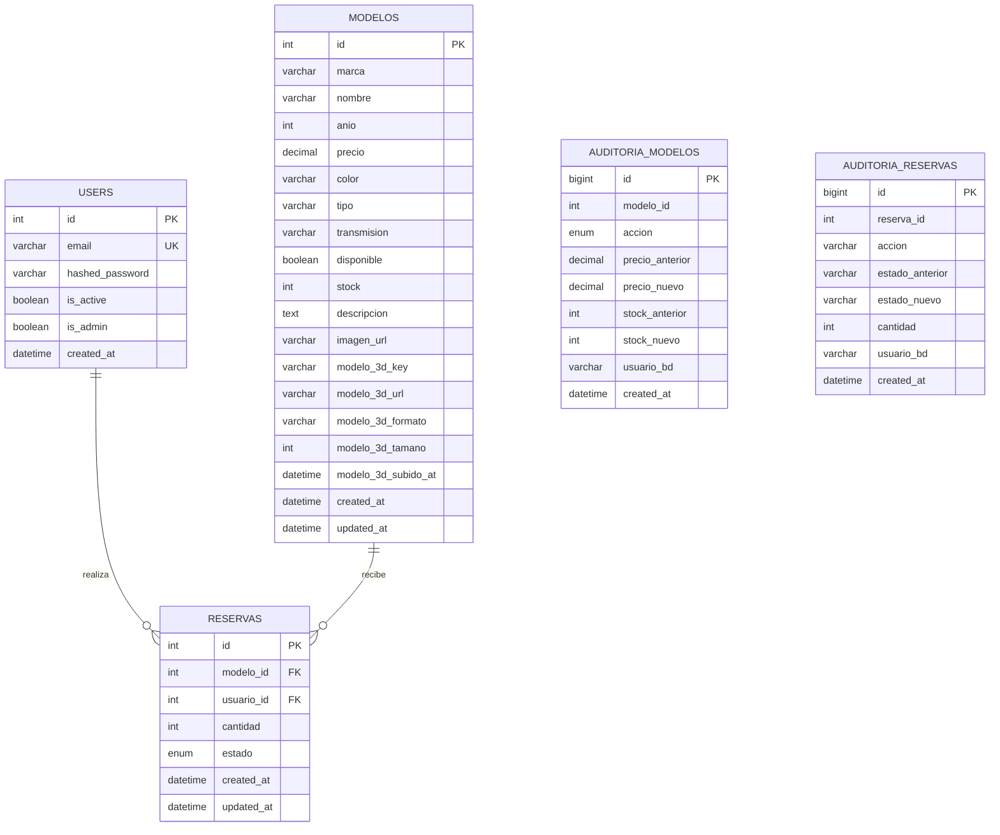

# TallerDB — Modelo de datos

**Proyecto:** TallerDB — Catálogo de Autos  
**Fecha:** 4 de noviembre de 2026  
**Motor oficial:** MariaDB 11 (InnoDB, `utf8mb4`, `utf8mb4_unicode_ci`)  
**Variantes documentadas:** PostgreSQL 16 y MySQL 8.4.

> **Etiquetas:** `EXISTE` = verificable en el repositorio; `INFERIDO` = deducido
> del DDL/código; `PROPUESTO` = incorporado en esta entrega; `NO ENCONTRADO` =
> sin evidencia.

---

## 1. Modelo conceptual

El sistema gira alrededor de tres entidades principales:

- **Usuario:** persona que se registra, inicia sesión y puede reservar.
- **Modelo:** auto del catálogo, con marca, nombre, año, precio, tipo, stock y
  datos 3D.
- **Reserva:** vínculo entre un usuario y un modelo, con cantidad y estado.

Se agregan dos entidades de **auditoría** (sin clave foránea, para conservar el
historial aunque se borre el registro original):

- **Auditoría de modelo:** cambios de precio, stock y disponibilidad.
- **Auditoría de reserva:** creación y cambios de estado.

### 1.1 Diagrama entidad-relación (Mermaid)



**Cardinalidad:** un usuario puede tener muchas reservas; un modelo puede tener
muchas reservas. Cada reserva pertenece a exactamente un usuario y a exactamente
un modelo. `PROPUESTO` para `reservas`; `EXISTE` para `users` y `modelos`.

---

## 2. Modelo relacional

```text
users (id PK, email UK, hashed_password, is_active, is_admin, created_at)

modelos (id PK, marca, nombre, anio, precio, color, tipo, transmision,
         disponible, stock, descripcion, imagen_url,
         modelo_3d_key, modelo_3d_url, modelo_3d_formato,
         modelo_3d_tamano, modelo_3d_subido_at, created_at, updated_at,
         UK (marca, nombre, anio))

reservas (id PK, modelo_id FK -> modelos.id, usuario_id FK -> users.id,
          cantidad, estado, created_at, updated_at)

auditoria_modelos (id PK, modelo_id, accion, precio_anterior, precio_nuevo,
                   stock_anterior, stock_nuevo, usuario_bd, created_at)

auditoria_reservas (id PK, reserva_id, accion, estado_anterior, estado_nuevo,
                    cantidad, usuario_bd, created_at)
```

### 2.1 Claves y restricciones

| Tabla | PK | FK | UNIQUE | CHECK | Otros |
|---|---|---|---|---|---|
| `users` | `id` | — | `email` | — | `is_active`, `is_admin` con default |
| `modelos` | `id` | — | `(marca, nombre, anio)` | `precio >= 0`, `stock >= 0` | `stock` default 1; `updated_at` con `ON UPDATE` |
| `reservas` | `id` | `modelo_id -> modelos.id`, `usuario_id -> users.id` | — | `cantidad > 0` | `estado` enum; FK con `ON DELETE CASCADE` |
| `auditoria_modelos` | `id` | — (histórico) | — | — | `accion` enum; índice `(modelo_id, created_at)` |
| `auditoria_reservas` | `id` | — (histórico) | — | — | índice `(reserva_id, created_at)` |

**Decisión:** las tablas de auditoría no tienen FK para no perder el historial
cuando se elimina un modelo o una reserva. `PROPUESTO`.

---

## 3. Normalización

### 3.1 Primera forma normal (1NF)

Todas las columnas contienen valores atómicos. No hay listas, arreglos ni grupos
repetidos. Cada reserva es una fila independiente. `EXISTE` para `users` y
`modelos`; `PROPUESTO` para `reservas`.

### 3.2 Segunda forma normal (2NF)

Todas las tablas tienen clave primaria de una sola columna (`id`). No existen
dependencias parciales de una clave compuesta. La clave candidata
`(marca, nombre, anio)` de `modelos` es un `UNIQUE`, no la PK; los demás
atributos dependen de `id`. `EXISTE`.

### 3.3 Tercera forma normal (3NF)

No hay dependencias transitivas dentro del alcance actual:

- En `modelos`, `precio`, `stock`, `tipo`, `transmision` dependen del modelo.
- En `reservas`, `cantidad` y `estado` dependen de la reserva.
- En `users`, los datos dependen del usuario.

**Observación:** `marca` se almacena como texto. Si en el futuro se requieren
atributos de la marca (país, logo, garantía), conviene crear una tabla `marcas`
y reemplazar `modelos.marca` por `marca_id`. Hoy no hay tales atributos, por lo
que el diseño es 3NF para el alcance. `INFERIDO`.

### 3.4 Redundancia controlada

`modelos.disponible` es una bandera de exhibición y `modelos.stock` es la
cantidad real. `disponible` es derivable de `stock > 0`, pero se conserva por
compatibilidad con la UI existente. `INFERIDO` del código actual.

**Invariante recomendada:** si `stock = 0`, el modelo no debe ofrecerse en el
catálogo. La vista `vw_modelos_disponibles` ya aplica `stock > 0`. `PROPUESTO`.

---

## 4. Diccionario de datos

### 4.1 `users`

| Columna | Tipo | Nulo | Default | Restricción |
|---|---|---|---|---|
| `id` | `INT` | No | AUTO_INCREMENT | PK |
| `email` | `VARCHAR(255)` | No | — | UNIQUE |
| `hashed_password` | `VARCHAR(255)` | No | — | — |
| `is_active` | `BOOLEAN` | No | 1 | — |
| `is_admin` | `BOOLEAN` | No | 0 | — |
| `created_at` | `DATETIME` | No | `CURRENT_TIMESTAMP` | — |

### 4.2 `modelos`

| Columna | Tipo | Nulo | Default | Restricción |
|---|---|---|---|---|
| `id` | `INT` | No | AUTO_INCREMENT | PK |
| `marca` | `VARCHAR(100)` | No | — | índice |
| `nombre` | `VARCHAR(120)` | No | — | índice |
| `anio` | `INT` | No | — | índice |
| `precio` | `DECIMAL(12,2)` | No | — | `CHECK (precio >= 0)` |
| `color` | `VARCHAR(50)` | Sí | NULL | — |
| `tipo` | `VARCHAR(40)` | No | `'sedan'` | índice |
| `transmision` | `VARCHAR(30)` | No | `'manual'` | — |
| `disponible` | `BOOLEAN` | No | 1 | índice |
| `stock` | `INT` | No | 1 | `CHECK (stock >= 0)` |
| `descripcion` | `TEXT` | Sí | NULL | — |
| `imagen_url` | `VARCHAR(500)` | Sí | NULL | — |
| `modelo_3d_key` | `VARCHAR(255)` | Sí | NULL | — |
| `modelo_3d_url` | `VARCHAR(500)` | Sí | NULL | — |
| `modelo_3d_formato` | `VARCHAR(10)` | Sí | NULL | — |
| `modelo_3d_tamano` | `INT` | Sí | NULL | — |
| `modelo_3d_subido_at` | `DATETIME` | Sí | NULL | — |
| `created_at` | `DATETIME` | No | `CURRENT_TIMESTAMP` | — |
| `updated_at` | `DATETIME` | No | `CURRENT_TIMESTAMP` | `ON UPDATE CURRENT_TIMESTAMP` |

**UNIQUE:** `(marca, nombre, anio)`.

### 4.3 `reservas`

| Columna | Tipo | Nulo | Default | Restricción |
|---|---|---|---|---|
| `id` | `INT` | No | AUTO_INCREMENT | PK |
| `modelo_id` | `INT` | No | — | FK `modelos.id`, `ON DELETE CASCADE` |
| `usuario_id` | `INT` | No | — | FK `users.id`, `ON DELETE CASCADE` |
| `cantidad` | `INT` | No | 1 | `CHECK (cantidad > 0)` |
| `estado` | `ENUM('pendiente','confirmada','cancelada')` | No | `'pendiente'` | — |
| `created_at` | `DATETIME` | No | `CURRENT_TIMESTAMP` | — |
| `updated_at` | `DATETIME` | No | `CURRENT_TIMESTAMP` | `ON UPDATE CURRENT_TIMESTAMP` |

### 4.4 `auditoria_modelos`

| Columna | Tipo | Nulo | Default | Restricción |
|---|---|---|---|---|
| `id` | `BIGINT` | No | AUTO_INCREMENT | PK |
| `modelo_id` | `INT` | No | — | índice |
| `accion` | `ENUM('INSERT','UPDATE','DELETE')` | No | — | — |
| `precio_anterior` | `DECIMAL(12,2)` | Sí | NULL | — |
| `precio_nuevo` | `DECIMAL(12,2)` | Sí | NULL | — |
| `stock_anterior` | `INT` | Sí | NULL | — |
| `stock_nuevo` | `INT` | Sí | NULL | — |
| `usuario_bd` | `VARCHAR(100)` | No | — | — |
| `created_at` | `DATETIME` | No | `CURRENT_TIMESTAMP` | — |

### 4.5 `auditoria_reservas`

| Columna | Tipo | Nulo | Default | Restricción |
|---|---|---|---|---|
| `id` | `BIGINT` | No | AUTO_INCREMENT | PK |
| `reserva_id` | `INT` | No | — | índice |
| `accion` | `VARCHAR(50)` | No | — | — |
| `estado_anterior` | `VARCHAR(20)` | Sí | NULL | — |
| `estado_nuevo` | `VARCHAR(20)` | Sí | NULL | — |
| `cantidad` | `INT` | Sí | NULL | — |
| `usuario_bd` | `VARCHAR(100)` | No | — | — |
| `created_at` | `DATETIME` | No | `CURRENT_TIMESTAMP` | — |

---

## 5. Índices

| Índice | Tabla | Columnas | Uso |
|---|---|---|---|
| `PRIMARY` | todas | `id` | Búsqueda por PK |
| `uq_modelo_marca_nombre_anio` | `modelos` | `marca, nombre, anio` | UNIQUE; evita duplicados |
| `ix_modelos_marca` | `modelos` | `marca` | Filtro por marca |
| `ix_modelos_nombre` | `modelos` | `nombre` | Búsqueda por nombre |
| `idx_modelos_tipo` | `modelos` | `tipo` | Filtro por tipo |
| `idx_modelos_disponible` | `modelos` | `disponible` | Filtro por disponibilidad |
| `idx_modelos_precio` | `modelos` | `precio` | Ordenamiento por precio |
| `idx_modelos_anio` | `modelos` | `anio` | Filtro por rango de años |
| `idx_modelos_tipo_disponible` | `modelos` | `tipo, disponible` | Filtro combinado |
| `ix_reservas_modelo_estado` | `reservas` | `modelo_id, estado` | Reservas activas por modelo |
| `ix_reservas_usuario` | `reservas` | `usuario_id` | Reservas por usuario |
| `idx_reservas_estado` | `reservas` | `estado` | Conteos por estado |
| `idx_reservas_created_at` | `reservas` | `created_at` | Reportes por fecha |

---

## 6. DDL físico

El esquema base está en:

- `database/schema_mariadb.sql` (MariaDB/MySQL)
- `database/schema_postgresql.sql` (PostgreSQL)
- `database/init/01_schema.sql` (copia para Docker)
- `database/init_postgres/01_schema.sql` (copia para Docker)

Las extensiones del Tema 4 están en:

- `database/08_stock_reservas.sql` — `stock`, `reservas`, auditoría.
- `database/09_indexes.sql` — índices adicionales.

### 6.1 Extensión de `modelos`

```sql
ALTER TABLE modelos
    ADD COLUMN IF NOT EXISTS stock INT NOT NULL DEFAULT 1
    AFTER disponible;

ALTER TABLE modelos
    ADD CONSTRAINT chk_modelos_stock CHECK (stock >= 0);

ALTER TABLE modelos
    ADD CONSTRAINT chk_modelos_precio CHECK (precio >= 0);
```

### 6.2 Tabla `reservas`

```sql
CREATE TABLE reservas (
    id          INT AUTO_INCREMENT PRIMARY KEY,
    modelo_id   INT NOT NULL,
    usuario_id  INT NOT NULL,
    cantidad    INT NOT NULL DEFAULT 1,
    estado      ENUM('pendiente', 'confirmada', 'cancelada')
                NOT NULL DEFAULT 'pendiente',
    created_at  DATETIME NOT NULL DEFAULT CURRENT_TIMESTAMP,
    updated_at  DATETIME NOT NULL DEFAULT CURRENT_TIMESTAMP
                ON UPDATE CURRENT_TIMESTAMP,
    CONSTRAINT fk_reservas_modelo
        FOREIGN KEY (modelo_id) REFERENCES modelos (id)
        ON DELETE CASCADE,
    CONSTRAINT fk_reservas_usuario
        FOREIGN KEY (usuario_id) REFERENCES users (id)
        ON DELETE CASCADE,
    CONSTRAINT chk_reservas_cantidad CHECK (cantidad > 0),
    KEY ix_reservas_modelo_estado (modelo_id, estado),
    KEY ix_reservas_usuario (usuario_id)
) ENGINE=InnoDB
  DEFAULT CHARSET=utf8mb4
  COLLATE=utf8mb4_unicode_ci;
```

### 6.3 Orden de ejecución

```text
1. database/schema_mariadb.sql
2. database/seed_modelos.sql
3. database/08_stock_reservas.sql
4. database/03_views.sql
5. database/05_functions.sql
6. database/04_procedures.sql
7. database/06_triggers.sql
8. database/09_indexes.sql
```

### 6.4 Rollback

```text
1. database/03_views_rollback.sql
2. database/04_procedures_rollback.sql
3. database/05_functions_rollback.sql
4. database/06_triggers_rollback.sql
5. database/08_stock_reservas_rollback.sql
6. database/09_indexes_rollback.sql
```

El rollback de `08` elimina triggers, tablas de auditoría, `reservas`,
restricciones `CHECK` y la columna `stock`. `EXISTE` y fue probado en esta
entrega.
